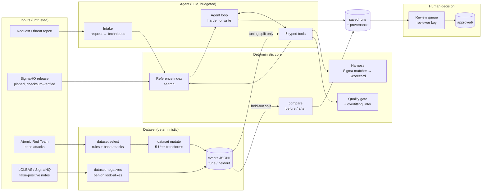
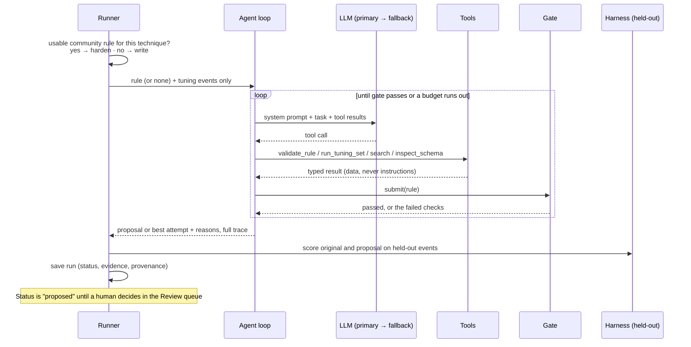

# DetectForge: Architecture

How the system is put together, how data and control move through it, and why it's built this way.
For the code itself see the [walkthrough](code-walkthrough.md); for the data formats, the
[interfaces](interfaces.md); for attackers and defences, the [threat model](threat-model.md); for what
can go wrong, the [failure matrix](failure-matrix.md).

## 1. The problem it serves

A detection team has rules for a technique and assumes it's covered. Uetz et al. (USENIX Security
2024) showed that many widely used Sigma rules miss the same attack once the command line is varied
in ways Windows ignores (quotes inserted, `-` instead of `/`, arguments reordered…). DetectForge
answers, per technique: **are we actually covered, and can we prove it?** It measures each rule's
**evasion resistance** (the share of behavior-preserving variations it still detects), has an agent
harden weak rules (or write one when none exists), and leaves every change to a human.

| User | Job | Where |
|---|---|---|
| SOC lead / manager | Where are we weak? Prove coverage to an auditor | UI: Coverage, coverage report |
| Detection engineer | A new threat came in: are we covered? Fix a weak rule | UI: New request, Rules; CLI |
| Senior reviewer | Approve or reject what the agent proposed, with evidence | UI: Review queue |
| Platform owner | What does the agent cost, is it failing? | UI: Agent operations; Langfuse traces |
| Researcher (us) | Before/after evaluation on held-out variations | CLI: `eval`, `harden-selection` |

## 2. Components

| Component | Code | Role | Model? |
|---|---|---|---|
| Reference index | `reference/` | Pinned SigmaHQ release; search by technique and keywords; marks rules that can never fire on our fields | no |
| Dataset | `dataset/` | Rule selection, base attacks, mutations, hard negatives, split into tune / held-out | no |
| Harness | `harness/` | Replays a rule on events, returns a scorecard; `compare` gives before/after per transform | no |
| Quality gate | `gate.py`, `rules/lint.py` | Validity, evasion resistance, false alarms, no lost attacks, deployability, overfitting checks | no |
| Intake | `intake.py` | Request or report → ATT&CK techniques (one typed tool; ids checked against the index) | yes |
| Agent loop | `agent/loop.py` | Hardens an existing rule, or writes one when none is usable | yes |
| Tools | `agent/tools.py` | `search_reference_rules`, `inspect_schema`, `validate_rule`, `run_tuning_set`, `submit` | no |
| Runner / batch | `agent/runner.py`, `agent/batch.py` | Chooses the path, scopes data, scores held-out after the run, saves it with provenance | no |
| Review | `review.py` | Decisions by authenticated reviewers; approved rules copied to `approved/` | no |
| Evaluation | `eval/` | Arms and metrics; regression gate on committed results | no |
| UI | `ui/` | Coverage, New request, Rules, Review queue, Agent operations | intake/agent only when enabled |
| Tracing | `tracing.py` | Every model and tool call to Langfuse (optional); always saved in the run file | no |

The model touches **two** places only (intake and the agent loop). Everything that produces a number
is plain, tested code.

## 3. One agent run

Budgets per run: model calls, tokens, tuning runs, submissions, per-answer output length, and
timeouts. A run that ends without a passing rule is saved as **needs human review** with its best
attempt and the reasons; nothing fails silently.

## 4. Data and the evaluation boundary

- **Events** (one JSON line each): Sysmon process-creation fields plus `label`, `technique`,
  `transform`, `base_id`, `split`. Every variant points to its base attack (`base_id`).
- **Split by transform type**: the agent tunes on some evasion types and is scored on the others. The
  `ToolContext` refuses held-out events at construction, so no tool, result or error message can reveal
  them. The held-out score is computed by the runner after the agent has finished.
- **Rule split**: dev rules for iterating on prompts; test rules run once, after prompts, model and
  loop are frozen.
- **Provenance**: each run records the prompt version, model, budgets and fingerprints of the code,
  the starting rule and the events. Runs with the same setup are reused, which spreads a batch over
  several days of free quota, and results from different setups are never mixed.

## 5. Deployment

| Where | What runs | Model | Approving |
|---|---|---|---|
| Laptop (development, evaluation, demo) | CLI + UI on `localhost` | OpenRouter free model; fallback model; optional local Ollama | on, with reviewer keys |
| Streamlit Community Cloud (public) | UI only | off (`DETECTFORGE_UI_ALLOW_AGENT_RUNS` unset) | off (no reviewer keys) |
| GitHub Actions | lint, all tests, eval regression gate | none (scripted fake model) | n/a |
| Windows 11 evaluation VM (isolated, snapshots) | base attacks and behavior checks of mutations | none | n/a |

Configuration is environment variables / `.env` only (`config.py`); switching the LLM provider is a
base URL and a model name.

## 6. Key design decisions

| Decision | Why | Alternative not taken |
|---|---|---|
| Harden existing rules first; write only as a fallback | Teams already run community rules; measuring and raising them is the honest question | Generate rules from scratch (no baseline to compare) |
| Deterministic harness, gate and comparison | Numbers must be reproducible and auditable; CI can gate them | LLM-as-judge for rule quality |
| Single agent with five typed tools | The task is one loop (revise → test); fewer moving parts, least privilege | Multi-agent planner/critic |
| Code chooses harden vs write | A routing decision with a clear rule shouldn't depend on a model | Let the model decide |
| Held-out split by transform type | Shows generalisation to evasions the agent never saw | Random split (leaks near-duplicates) |
| Human approval, authenticated by reviewer key | The agent may follow injected text; only a person can approve | Auto-deploy on gate pass |
| Pure-Python matcher over JSON events | Fast, testable, no SIEM needed; pySigma for parsing and conversion | Replaying EVTX through a SIEM |
| Free OpenRouter model, provider-agnostic client | Zero budget; any OpenAI-compatible endpoint (incl. local Ollama) by configuration | Paid frontier model |
| Everything saved in the run file, tracing optional | Evidence survives without the tracing backend | Tracing backend as the only record |
